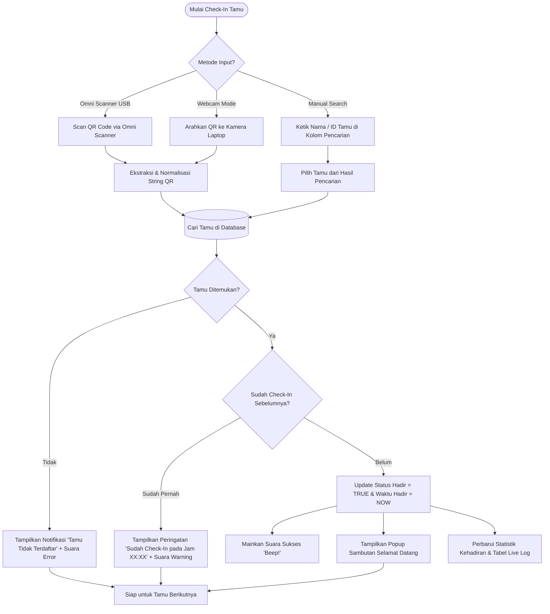

# PRODUCT REQUIREMENT DOCUMENT (PRD)
## Sistem Check-In & Absensi Tamu Undangan Berbasis QR Code
**Proyek:** Sistem Buku Tamu Digital (Wedding Check-In System)  
**Acara:** Resepsi Pernikahan Wildan & Aisyah  
**Dokumen Versi:** 1.0.0  
**Status:** Approved / Siap Implementasi  
**Penyusun:** Antigravity AI Engineering Team  

---

## 1. Executive Summary & Latar Belakang

### 1.1 Latar Belakang
Pada acara resepsi pernikahan berskala ratusan hingga ribuan tamu, proses pencatatan kehadiran manual (buku tamu fisik bertinta) sering kali menimbulkan antrean panjang, ketidakteraturan data, kesulitan verifikasi tamu, dan laporan kehadiran yang lambat.

Untuk resepsi **Wildan & Aisyah**, database undangan telah dipersiapkan sebanyak **505 tamu** yang masing-masing telah memiliki **ID Tamu** dan **QR Code khusus**. Diperlukan sistem digital absensi tamu yang cepat (< 1 detik per tamu), andal, offline-ready, serta mendukung transisi perangkat dari mode pengujian (*trial & error* via Webcam laptop) hingga produksi resmi (*on-site* menggunakan Barcode Scanner Omni).

### 1.2 Tujuan Sistem
1. **Mempercepat Alur Masuk (Queue Reduction):** Proses check-in tamu selesai dalam hitungan detik tanpa mengetik manual.
2. **Dual-Input Compatibility:** Dapat dijalankan menggunakan **Webcam** (untuk fase pengujian/kamera laptop) maupun **Barcode Scanner Omni** (mode USB HID keyboard emulation untuk hari H) tanpa konfigurasi ulang kode.
3. **Pencegahan Duplikasi (Anti-Double Check-In):** Mencegah QR code yang sama di-scan berulang kali dengan memberikan indikator visual & audio yang jelas.
4. **Live Monitoring & Analytics:** Menyajikan dashboard real-time yang memvisualisasikan jumlah tamu hadir vs belum hadir, grafik waktu kedatangan, serta kategori tamu.
5. **Pencarian Manual Cepat (Fallback Mechanism):** Fasilitas pencarian instan berdasarkan Nama atau ID Tamu apabila tamu lupa membawa undangan fisik/digital atau QR code rusak.
6. **Ekspor Data Pasca Acara:** Menghasilkan rekapitulasi kehadiran tamu ke format Excel (.xlsx / .csv).

---

## 2. Analisis Data Sumber (Data Audit)

Berdasarkan audit teknis terhadap file data utama `QR List Tamu Undangan - WILDAN AISYAH - ID dan QR.pdf`:

| Parameter | Keterangan / Hasil Temuan |
| :--- | :--- |
| **Sumber File** | `QR List Tamu Undangan - WILDAN AISYAH - ID dan QR.pdf` |
| **Jumlah Halaman** | 85 Halaman |
| **Total Tamu** | **505 Tamu Undangan** (No. 1 s/d 505) |
| **Struktur Tabel PDF** | Kolom: `No`, `Nama`, `ID Tamu`, `QR CODE` (Gambar) |
| **Format ID Tamu** | Alphanumerik 7 karakter unik (Contoh: `FNE0001`, `DNE0002`, `PPE0504`) |
| **Payload/Konten QR Code** | String format teks: `[Nama Tamu]|[Kategori/Grup]`<br>Contoh: `Firsan Nova|NEXUS`, `Nuril Qamary|TKIT ULIL ALBAB`, `Lik Suti|KELUARGA SEMALANG` |

> [!IMPORTANT]
> **Karakteristik Payload QR:**  
> QR Code tidak hanya berisi ID Tamu, melainkan berisi pola teks pemisah pipa `Nama|Kategori`. Sistem parser harus mampu mengenali input ini, memecahnya (*split by delimiter `|`*), dan mencocokkannya ke database (baik dicocokkan berdasarkan Nama, ID Tamu, ataupun payload mentah).

---

## 3. Rekomendasi Teknologi & Framework Optimal

### 3.1 Pilihan Arsitektur: Web-Based Application (Modern Web Stack)
**Rekomendasi Utama: Single Page Application (SPA) Berbasis Web (HTML5, Modern JavaScript ES6+, Tailwind/Vanilla CSS, didukung Backend Ringan Node.js/Express atau Python FastAPI/Flask, atau 100% Client-Side Offline dengan IndexedDB/LocalStorage).**

### 3.2 Mengapa Web-Based adalah Solusi Paling Optimal & Sederhana?
1. **Kompatibilitas Alami Barcode Scanner Omni (USB HID):**  
   Scanner Omni bekerja sebagai *USB Keyboard Emulation*. Saat memindai QR, alat ini langsung mengetik string dan mengakhiri dengan karakter `Enter` (`\n`). Pada aplikasi web, ini ditangkap semudah event `keypress` / `keydown` pada `<input>` field tanpa memerlukan driver hardware atau library C++/serial port khusus.
2. **Kemudahan Webcam untuk Trial & Error:**  
   Browser modern memiliki API standar `navigator.mediaDevices.getUserMedia` yang sangat matang. Dengan library seperti `html5-qrcode` atau `zxing-js`, scanner webcam berjalan langsung di browser tanpa instalasi software tambahan.
3. **UI/UX Resepsi yang Mewah & Fleksibel:**  
   Aplikasi web memudahkan pembuatan antarmuka modern yang estetik (tema wedding elegan: gold/navy/glassmorphism), animasi sambutan tamu (*greeting screen*), modal interaktif, dan pemutaran audio feedback (efek suara *ding* sukses & suara peringatan).
4. **Offline-First & Portabilitas:**  
   Dapat dijalankan secara lokal di laptop resepsionis (bahkan tanpa koneksi internet) menggunakan file lokal atau local development server.

### 3.3 Stack Komponen yang Dipilih

```
+-----------------------------------------------------------------------+
|                            USER INTERFACE                             |
|  - Receptionist Screen (Input Scanner, Search Bar, Table Kehadiran)   |
|  - Live Display Screen (Greeting Banner Tamu Datang & Statistik)      |
+-----------------------------------+-----------------------------------+
                                    |
+-----------------------------------+-----------------------------------+
|                           INPUT HANDLERS                              |
|  1. Omni Barcode Scanner (Keyboard HID Event Listener on Input)       |
|  2. Laptop Webcam Scanner (HTML5-QRCode / ZXing Video Stream)         |
|  3. Manual Search & Check-in (Instant Fuzzy Search by Name/ID)        |
+-----------------------------------+-----------------------------------+
                                    |
+-----------------------------------+-----------------------------------+
|                        APPLICATION LOGIC                              |
|  - QR Code Parser & Normalizer (Handles "Nama|Kategori" & ID)         |
|  - Check-in Validator (Duplicate check, Timestamp recorder)           |
|  - Audio Feedback Engine (Web Audio API: Beep Success / Warning)       |
+-----------------------------------+-----------------------------------+
                                    |
+-----------------------------------+-----------------------------------+
|                         DATA PERSISTENCE                              |
|  - In-Memory / IndexedDB / LocalStorage / SQLite                      |
|  - Auto-Export to CSV / Excel File                                    |
+-----------------------------------------------------------------------+
```

- **Frontend Core:** HTML5, CSS3 (Modern Glassmorphism & Wedding Theme), JavaScript ES6+.
- **QR Decoding (Webcam):** `html5-qrcode` library (ringan, akurat, mendukung autofocus kamera).
- **Scanner Omni Handling:** Keystroke Buffer Listener (mendengarkan input cepat dari scanner berakhiran `Enter`).
- **Data Extractor (Pre-processing):** Python script (`pypdf` + `cv2`) untuk mengekstrak seluruh 505 data tamu dari PDF menjadi `guests.json` dan `database.sqlite`.
- **Ekspor Data:** `SheetJS` (`xlsx.full.min.js`) untuk ekspor instan ke Excel.

---

## 4. Mekanisme Kerja Hardware Scanner

### 4.1 Mode 1: Barcode Scanner Omni (Mode Produksi Hari H)
- **Koneksi:** Kabel USB Plug & Play (tanpa instalasi driver khusus di Windows).
- **Prinsip Operasi:** Perangkat berfungsi sebagai piranti masukan keyboard (Human Interface Device).
- **Alur Kerja:**
  1. Operator mengarahkan QR code tamu ke hadapan jendela Omni Scanner.
  2. Omni Scanner memancarkan sensor multi-arah dan memindai QR code dalam milidetik.
  3. Scanner mengirimkan teks payload (contoh: `Firsan Nova|NEXUS`) ke komputer secara instan diikuti penekanan tombol `Enter`.
  4. Aplikasi menangkap event `Enter`, memproses pencocokan data tamu, mencatat jam kehadiran, membunyikan suara sukses, dan menampilkan kartu sambutan tamu.
  5. Input field otomatis dikosongkan dan difokuskan kembali untuk tamu berikutnya.

### 4.2 Mode 2: Webcam Scanner (Mode Uji Coba / Trial & Error)
- **Koneksi:** Kamera terintegrasi laptop atau Webcam USB eksternal.
- **Prinsip Operasi:** Stream video 30 FPS diolah oleh canvas HTML5 dan engine deteksi QR (`html5-qrcode`).
- **Alur Kerja:**
  1. Operator mengaktifkan tombol "Gunakan Kamera Webcam".
  2. Kamera menampilkan viewfinder interaktif di layar.
  3. Ketika QR code terdeteksi dalam frame kamera, event `onScanSuccess(decodedText)` dipicu.
  4. Video stream dijeda sesaat (cooldown 2 detik) agar tidak terjadi multi-trigger pada QR yang sama.
  5. Sistem menjalankan alur check-in yang identik dengan scanner Omni.

---

## 5. Alur Pengguna & User Journey



---

## 6. Kebutuhan Fungsional (Functional Requirements)

### 6.1 Modul Ekstraksi Data (Pre-Condition)
- **FR-01 (Ekstraksi PDF ke Basis Data):** Sistem menyediakan skrip otomasi untuk membaca file PDF `QR List Tamu Undangan - WILDAN AISYAH - ID dan QR.pdf`, mengekstrak ke-505 baris tamu (No, Nama, ID Tamu, QR Payload), dan menyimpannya dalam format terstruktur (`guests.json` dan SQLite).
- **FR-02 (Data Seeding & Inisialisasi):** Saat aplikasi web dibuka, seluruh data tamu langsung termuat ke dalam memori aplikasi dengan status awal `Hadir = FALSE`.

### 6.2 Modul Input & Scanner
- **FR-03 (Omni Scanner Auto-Focus):** Kolom input scanner utama selalu mempertahankan fokus kursor (*auto-refocus*), sehingga operator tidak perlu mengklik mouse setiap kali akan melakukan pemindaian.
- **FR-04 (Webcam Scanner Integration):** Pengguna dapat menyalakan/mematikan pemindaian via webcam dengan satu klik, lengkap dengan pemilihan device kamera (kamera depan/belakang).
- **FR-05 (Fuzzy Manual Search):** Fitur pencarian instan nama tamu toleran terhadap salah ketik kecil atau pencarian sebagian nama (misal ketik "Wildan" atau "Khey").
- **FR-06 (Manual Check-In Button):** Tombol "Check-in Manual" pada baris tabel tamu untuk tamu yang tidak membawa QR.

### 6.3 Modul Validasi & Kehadiran
- **FR-07 (QR Parser Resilient):** Parser mampu membedakan apakah teks yang masuk berupa format gabungan `Nama|Kategori`, hanya `ID Tamu` (misal `FNE0001`), atau hanya `Nama`.
- **FR-08 (Anti-Double Check-In):** Jika tamu yang sama di-scan untuk kedua kalinya, sistem menolak check-in ulang dan menampilkan waktu kedatangan pertamanya.
- **FR-09 (Manual Check-in Undo / Toggle):** Administrator dapat membatalkan status check-in (*Undo*) jika terjadi salah input.

### 6.4 Modul Feedback & Antarmuka
- **FR-10 (Audio Feedback System):**  
  - Suara *Chime Sukses* (nada tinggi menyenangkan) untuk check-in berhasil.  
  - Suara *Buzz Warning* (nada rendah ganda) untuk tamu yang sudah pernah check-in.  
  - Suara *Error Alert* untuk QR tidak dikenal.
- **FR-11 (Welcome Greeting Card Modal):** Pop-up besar yang menampilkan:
  - Ucapan: *"Selamat Datang di Pernikahan Wildan & Aisyah"*
  - Nama Tamu (Font besar, elegan)
  - Kategori Tamu (misal: *KELUARGA SEMALANG*, *NEXUS*, *KULIAH UI*)
  - Waktu Kehadiran Tercatat (Jam:Menit:Detik)
  - Durasi tampil otomatis menutup dalam 3 detik atau saat tombol Enter/Space ditekan.

### 6.5 Modul Monitoring & Laporan
- **FR-12 (Statistik Ringkasan Real-Time):** Menampilkan metrik utama di bagian atas layar:
  - Total Undangan (505)
  - Total Tamu Hadir
  - Total Tamu Belum Hadir
  - Persentase Tingkat Kehadiran (%)
- **FR-13 (Live Recent Check-in Feed):** Daftar tabel aktivitas 10 tamu terakhir yang baru saja masuk secara berurutan.
- **FR-14 (Export to Excel / CSV):** Tombol satu klik untuk mengunduh laporan lengkap kehadiran berformat `.xlsx` berisi kolom: No, ID Tamu, Nama, Kategori, Status Kehadiran (Hadir/Belum), dan Waktu Hadir.

---

## 7. Kebutuhan Non-Fungsional (Non-Functional Requirements)

1. **Kecepatan Respons (Performance):**
   - Waktu respons pemrosesan pemindaian hingga munculnya visual feedback harus di bawah **250 milidetik**.
   - Beban rendering UI lancar pada 60 FPS di laptop standar resepsionis.
2. **Kemandirian Jaringan (Offline Capability):**
   - Seluruh sistem wajib dapat berfungsi 100% tanpa sambungan internet (Zero Cloud Dependency). Data disimpan di penyimpanan lokal browser (*LocalStorage/IndexedDB*) atau server lokal.
3. **Ketahanan Data (Data Persistence & Safety):**
   - Status kehadiran yang telah dicatat tidak boleh hilang jika halaman web di-refresh atau browser tertutup secara tidak sengaja.
4. **Ergonomi & Aksesibilitas Visual:**
   - Kontras warna tinggi, teks nama tamu terbaca jelas dari jarak 1,5 meter oleh resepsionis.
   - Tersedia tombol cepat (*hotkeys*) seperti `Esc` untuk menutup pop-up, `F2` untuk toggle kamera webcam.

---

## 8. Desain Struktur Data & Database Schema

### 8.1 Model Entitas Tamu (Guest Entity)
Setiap rekaman tamu memiliki struktur data sebagai berikut:

```json
{
  "id": "FNE0001",
  "no": 1,
  "name": "Firsan Nova",
  "category": "NEXUS",
  "qr_payload": "Firsan Nova|NEXUS",
  "is_present": true,
  "checked_in_at": "2026-09-07T10:15:32.000Z",
  "pax": 1,
  "notes": ""
}
```

### 8.2 Database Schema (SQLite / IndexedDB)
```sql
CREATE TABLE guests (
    id VARCHAR(20) PRIMARY KEY,       -- Contoh: 'FNE0001'
    no_urut INTEGER NOT NULL,          -- Nomor urut (1-505)
    name VARCHAR(150) NOT NULL,        -- Nama lengkap tamu
    category VARCHAR(100),             -- Grup/Kategori (misal: 'NEXUS', 'KELUARGA')
    qr_payload VARCHAR(255),           -- Nilai raw yang tersimpan dalam QR
    is_present BOOLEAN DEFAULT 0,      -- 0: Belum Hadir, 1: Sudah Hadir
    checked_in_at TIMESTAMP NULL,      -- Waktu absensi
    pax INTEGER DEFAULT 1,             -- Jumlah orang/jatah
    notes TEXT NULL                    -- Catatan tambahan (opsional)
);

CREATE INDEX idx_guests_name ON guests(name);
CREATE INDEX idx_guests_qr ON guests(qr_payload);
CREATE INDEX idx_guests_presence ON guests(is_present);
```

---

## 9. Desain Antarmuka Pengguna (UI/UX Layout)

Antarmuka dirancang dengan tema pernikahan modern (*modern wedding aesthetic*: kombinasi warna Champagne Gold, Emerald Green / Royal Navy, dan Dark Glassmorphism).

```
+-----------------------------------------------------------------------------------------------+
| [LOGO / CINCIN]  RESEPSI PERNIKAHAN WILDAN & AISYAH - GUEST CHECK-IN SYSTEM   [Jam: 10:45:12] |
+-----------------------------------------------------------------------------------------------+
|  STATISTIK KEHADIRAN                                                                          |
|  [ Total Undangan: 505 ]   [ Hadir: 142 (28%) ]   [ Belum Hadir: 363 ]   [ Tamu Baru: 3 mnt ] |
+-----------------------------------------------------------------------------------------------+
|  INPUT SCANNER & PENCARIAN TAMU                                                               |
|  [ SCAN BARCODE / KETIK NAMA TAMU DISINI...                          ] [Buka Webcam] [Export] |
+-------------------------------------------------------+---------------------------------------+
|  LIVE KAMERA WEBCAM (Jika Diaktifkan)                 |  TAMU BARU SAJA HADIR (RECENT FEED)   |
|  +-------------------------------------------------+  |  1. Mas Akbar (NEXUS) - 10:44:20      |
|  | [ Kamera Aktif - Arahkan QR Tamu ke Kotak Ini ] |  |  2. Firsan Nova (NEXUS) - 10:43:10    |
|  +-------------------------------------------------+  |  3. Dudy S. Takdir (NEXUS) - 10:41:05 |
+-------------------------------------------------------+---------------------------------------+
|  DAFTAR LENGKAP TAMU UNDANGAN (Dapat Disaring: Semua | Hadir | Belum Hadir)                   |
|  +----+---------+----------------------+--------------------+-----------+-------------------+ |
|  | No | ID Tamu | Nama Tamu            | Kategori           | Status    | Waktu Check-In    | |
|  +----+---------+----------------------+--------------------+-----------+-------------------+ |
|  | 1  | FNE0001 | Firsan Nova          | NEXUS              | [ HADIR ] | 10:43:10          | |
|  | 2  | DNE0002 | Dudy S. Takdir       | NEXUS              | [ HADIR ] | 10:41:05          | |
|  | 3  | MNE0003 | Mas Akbar            | NEXUS              | [ HADIR ] | 10:44:20          | |
|  | 4  | MNE0004 | Mas Rakyan           | NEXUS              | [ BELUM ] | - [Check-in Manual] |
+-----------------------------------------------------------------------------------------------+
```

---

## 10. Rencana Implementasi Bertahap (Implementation Roadmap)

### Fase 1: Data Extraction & Pre-Processing (Pondasi Data)
- Membuat skrip Python `extract_guests.py` untuk mengurai seluruh 85 halaman PDF `QR List Tamu Undangan - WILDAN AISYAH - ID dan QR.pdf`.
- Mengonversi teks tabel dan membaca payload QR code ke dalam file data terstruktur `guests_master.json`.
- Memvalidasi kelengkapan 505 data tamu tanpa ada baris yang terlewat.

### Fase 2: Pembangunan Core Aplikasi Web & UI
- Membangun struktur antarmuka single-page web responsif yang elegan (*luxury wedding design*).
- Mengintegrasikan sistem audio synthesizer menggunakan Web Audio API untuk suara Beep Sukses, Warning, dan Gagal tanpa ketergantungan file audio eksternal.
- Mengimplementasikan state management lokal (status kehadiran disimpan ke `localStorage` agar aman saat refresh).

### Fase 3: Integrasi Dual Scanner (Webcam & Omni Scanner)
- Memasang library `html5-qrcode` untuk modul scan webcam real-time.
- Memprogram keyboard listener cerdas untuk Omni Barcode Scanner (deteksi masukan cepat otomatis berakhiran *Enter*).
- Menambahkan auto-focus loop agar kolom scanner tidak pernah kehilangan fokus.

### Fase 4: Pengujian, Simulasi & Export
- Uji coba skenario pemindaian QR menggunakan webcam laptop dengan sampel QR dari PDF.
- Uji coba penanganan duplikasi check-in (tamu yang sama di-scan 2x).
- Uji coba ekspor laporan kehadiran ke format Excel `.xlsx`.
- Validasi performa dan kesiapan pakai saat hari H menggunakan Barcode Scanner Omni.

---

## 11. Strategi Mitigasi Masalah (Contingency Plan)

| Potensi Kendala | Kemungkinan Dampak | Solusi & Mitigasi |
| :--- | :--- | :--- |
| **Kamera Webcam buram / pencahayaan redup** | QR lambat terbaca saat trial | Sediakan fitur manual search; atur kecerahan & gunakan Omni Scanner berlampu LED merah untuk hari H. |
| **QR Code Tamu rusak / terlipat** | Scanner tidak dapat mendeteksi QR | Petugas meja resepsionis cukup mengetikkan 3 huruf nama tamu pada kolom pencarian dan menekan tombol *Check-in Manual*. |
| **Laptop resepsionis mati mendadak / restart** | Hilangnya data tamu yang sudah absen | Seluruh status kehadiran disimpan *per-transaksi* ke `localStorage`/IndexedDB seketika itu juga. Saat web dibuka kembali, data langsung pulih. |
| **Tamu membawa keluarga lebih dari 1 orang** | Jumlah piring/souvenir tidak akurat | Tersedia tombol edit jumlah *Pax* (+ / -) pada pop-up sambutan tamu. |
| **Koneksi internet mati di gedung pernikahan** | Sistem web tidak dapat diakses jika bergantung pada cloud | Aplikasi dirancang **100% Offline-First**. Seluruh aset JavaScript, CSS, dan database tersimpan di mesin lokal laptop. |

---

## 12. Kesimpulan & Rekomendasi Langkah Selanjutnya

Pendekatan aplikasi **Web-Based Offline-First** adalah solusi terbaik, tercepat, dan paling andal untuk kebutuhan absensi tamu Wildan & Aisyah. Pendekatan ini menyelesaikan kebutuhan fase *trial & error* (dengan webcam) sekaligus siap 100% dipasangkan dengan *Barcode Scanner Omni* tanpa perubahan arsitektur apapun.

Langkah berikutnya yang disarankan:
1. Menjalankan skrip ekstraksi data dari file PDF `QR List Tamu Undangan - WILDAN AISYAH - ID dan QR.pdf` ke format JSON.
2. Membangun aplikasi web check-in interaktif lengkap dengan tampilan UI mewah, scanner webcam, listener Omni scanner, dan fitur ekspor Excel.
